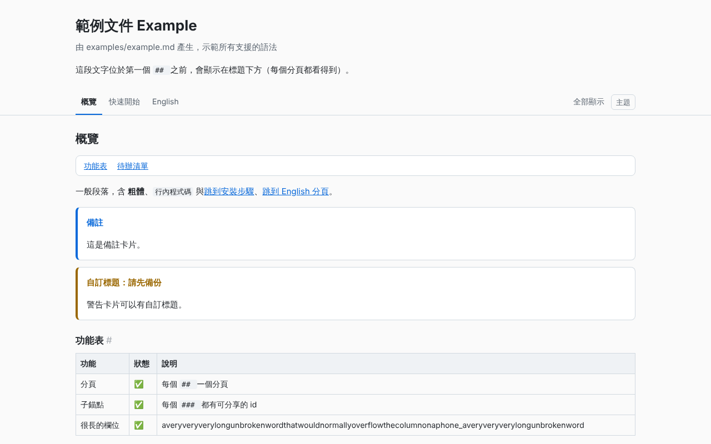

## 概覽 {#overview}

本 repo 的說明文件規則是「給人看的 HTML、分頁/錨點導覽、UTF-8 無 BOM、整檔寫入、每次寫入後稽核、中文為主附英文」。以前每份 README.html 都是手寫的；**md2tabs** 讓之後的文件直接用 Markdown 寫，產生器自動做出符合規則的頁面。

| 項目 | 說明 |
|---|---|
| 輸入 | 一個 `.md` 檔，或一個資料夾（每個 `*.md` 各產生一個 `.html`，另外產生 `index.html` 索引） |
| 分頁 | 每個 `## ` 標題 = 一個分頁；`### ` 標題 = 可分享的子錨點（深連結會自動切到所在分頁並捲動到該處） |
| 語法 | CommonMark + GFM 表格、圍欄程式碼、任務清單 `- [ ]`、告示卡片 `> [!NOTE]`、圖片（`--embed-images` 內嵌） |
| 輸出 | 單一 HTML（CSS/JS 全部內嵌、不用 CDN）、「全部顯示」模式、列印樣式、淺色/深色、手機表格只在表格內捲動 |
| 編碼 | 輸入的 BOM/CRLF 自動正規化；不是 UTF-8（例如 Big5）會拒絕並說明，不會默默產生亂碼；輸出 UTF-8 無 BOM、原子寫入後立即讀回稽核 |
| 驗證 | `--check`：內部連結/錨點都要存在、沒有重複 id、每個分頁都有內容，否則結束碼 1 |
| 介面語言 | CLI 訊息 zh-TW / en（`--lang en`）；頁面 UI 依 front matter 的 `lang` |

> [!NOTE] 自我驗證（dogfooding）
> 這份 README.html 由 `npm run build:docs` 從 [docs/README.md](README.md) 產生，並經過 `--check` 與 Playwright 測試；範例輸出見 [examples/example.html](../examples/example.html)。

### 檔案結構

| 路徑 | 用途 |
|---|---|
| `src/cli.js` | 指令列入口（build / check / help / version） |
| `src/render.js` | markdown-it 解析、告示卡片、任務清單、標題 id、依 `## ` 切分頁、圖片/連結改寫 |
| `src/template.js` | 自包含頁面模板（CSS + 分頁腳本） |
| `src/slug.js` | 錨點 id 規則（支援中文） |
| `src/io.js` | 輸入解碼（BOM/CRLF/編碼檢查）與原子寫入 + 寫後稽核 |
| `src/check.js` | `--check` 驗證 |
| `src/build.js` | 單檔 / 資料夾建置 |
| `src/env.js`、`src/i18n.js` | 日誌、版本、語言字串 |
| `docs/README.md` | 本文件原始檔 |
| `examples/` | 範例 Markdown、產生的 HTML、截圖 |
| `testdata/big5.md` | 故意存成 Big5 的測試輸入（`tools/audit-text.mjs` 會略過此資料夾） |
| `test/` | 單元、CLI、Playwright 端對端測試 |

## 快速開始（Windows / Linux） {#quickstart}

需求：Node.js 20 以上（已在 Node 22 測試）。Playwright 只有跑測試時需要。

### Windows

1. 在檔案總管雙擊 `setup.bat`（執行 `npm install`）。
2. 雙擊 `build-docs.bat`：重新產生本頁 `README.html` 與 `examples/example.html`，並自動 `--check`。
3. 轉換自己的檔案：在命令提示字元執行

```bat
md2tabs.bat build C:\path\to\guide.md --out C:\path\to\guide.html --check
md2tabs.bat build C:\path\to\docs-folder --check
```

4. 跑測試：雙擊 `run-tests.bat`。

> [!TIP]
> 所有 `.bat` 都是純 ASCII + CRLF，會先 `pushd` 到專案資料夾、印出路徑與結束碼，最後 `pause`。實際工作由 `md2tabs.ps1`（UTF-8 BOM）呼叫 node 完成。設定環境變數 `MD2TABS_NO_PAUSE=1` 可略過 pause（給自動化用）。

### Linux / macOS

```bash
npm install
npm run build:docs        # 產生 README.html（含 --check）
npm run build:example     # 產生 examples/example.html
node src/cli.js build guide.md --out guide.html --check
node src/cli.js build docs/ --out site/ --check   # 資料夾模式
npm test
```

### 指令與選項

| 選項 | 說明 |
|---|---|
| `build <檔案.md>` | 單檔模式；預設輸出同名 `.html` |
| `build <資料夾>` | 資料夾模式：每個 `*.md`（不遞迴）→ `.html`，並產生 `index.html`（若資料夾內已有 `index.md` 則不產生） |
| `check <檔案.html>` | 只驗證既有 HTML |
| `--out <路徑>` | 輸出檔或輸出資料夾 |
| `--check` | 建置後驗證，有問題結束碼 1 |
| `--embed-images` | 本機圖片轉成 data URI；單張超過 `--max-image-kb`（預設 1024）會警告 |
| `--allow-invalid` | 輸入不是合法 UTF-8 時仍輸出（不建議） |
| `--lang zh-TW` / `--lang en` | CLI 訊息語言 |
| `--debug` | 日誌層級 debug，並同步印到 stderr |
| `--log-dir <資料夾>` / `--no-log` | 日誌位置 / 不寫日誌 |

結束碼：`0` 成功、`1` `--check` 發現問題、`2` 用法錯誤、`3` 輸入編碼錯誤、`4` 讀寫錯誤。

## 使用說明（語法） {#usage}

### 分頁與錨點如何對應

| Markdown | 產生結果 | 網址 |
|---|---|---|
| front matter `title:` 或第一個 `# ` | 頁面大標題（第一個 `# ` 會從內文移除） | — |
| 第一個 `## ` 之前的文字 | 顯示在標題下方，每個分頁都看得到 | — |
| `## 快速開始` | 分頁按鈕 +「`<section class="tab" id="快速開始">`」 | `README.html#快速開始` |
| `## 概覽 {#overview}` | 自訂 id 的分頁 | `README.html#overview` |
| `### 安裝步驟` | 子錨點 `<h3 id="安裝步驟">`，旁邊有 `#` 可複製連結；分頁內有 2 個以上時自動產生「本頁目錄」 | `README.html#安裝步驟` 會先切到所在分頁再捲動過去 |
| `#### ` 以下 | 也有 id，可深連結 | 同上 |
| （保留字） | `#all` = 全部顯示 | `README.html#all` |

沒有任何 `## ` 的文件會放進單一分頁並警告。

### Front matter（選用）

```markdown
---
title: 文件標題
subtitle: 一行副標
lang: zh-TW
footer: 頁尾文字
---
```

`lang` 決定 `<html lang>`、告示卡片標籤與「全部顯示」等 UI 文字（`en` 開頭 = 英文，其餘 = 中文）。

### 告示卡片

```markdown
> [!NOTE]
> 一般備註。

> [!WARNING] 自訂標題：請先備份
> 第一行 [!TYPE] 後面的文字會成為卡片標題。
```

支援 `NOTE`（備註）、`TIP`（提示）、`IMPORTANT`（重要）、`WARNING`（警告）、`CAUTION`（小心），大小寫不拘。效果：

> [!WARNING]
> 這是一張警告卡片。

### 任務清單、表格、程式碼

```markdown
- [x] 已完成
- [ ] 未完成

| 欄 1 | 欄 2 |
|---|---|
| a | b |
```

- [x] 已完成
- [ ] 未完成

表格一律包在 `.table-wrap` 中：窄螢幕時只有表格本身水平捲動，頁面不會。圍欄程式碼會加上 `class="language-xxx"`（目前不做語法上色）。

### 圖片與連結

- 相對路徑以 **Markdown 檔所在資料夾** 為準，輸出時改寫成相對 **輸出 HTML** 的路徑。
- `--embed-images`：png / jpg / gif / svg / webp 轉成 data URI，HTML 可單獨寄送；單張超過 1024 KB 警告。
- 資料夾模式下，連到其他 `.md` 的連結自動改成 `.html`（互相連結可直接用）；單檔模式保留原本的 `.md` 連結。
- 頁內 `#中文錨點` 連結保持原字元，與 id 完全一致。

## 逐步驗證指南 {#verify}

以下每一步都附「預期結果」，全部在 Linux（Node 22.23.4）實際跑過。

### 步驟 1：安裝

```bash
npm install
```

預期：安裝 markdown-it 14.1.0 與 playwright 1.63.0（瀏覽器使用環境已有的 Chromium；若沒有，執行 `npx playwright install chromium`）。

### 步驟 2：產生範例並驗證

```bash
npm run build:example
```

預期輸出：

```text
✔ examples/example.md → examples/example.html（3 個分頁，… bytes，UTF-8 無 BOM）
✔ 檢查通過 examples/example.html（33 項）
```

用瀏覽器開啟 [examples/example.html](../examples/example.html)：有「概覽 / 快速開始 / English」三個分頁、右側「全部顯示」與「主題」按鈕。

### 步驟 3：測試深連結

開啟 `examples/example.html#安裝步驟`。預期：直接顯示「快速開始」分頁，並捲動到「安裝步驟」標題。點「全部顯示」：三個分頁全部展開；按 Ctrl+P 列印預覽也會包含全部內容。

### 步驟 4：--check 抓壞連結

```bash
printf '## 概覽\n\n[壞](#不存在)\n' > /tmp/bad.md
node src/cli.js build /tmp/bad.md --check; echo "exit=$?"
```

預期：`✖ 檢查發現 1 個問題`、`- broken anchor #不存在`、`exit=1`。

### 步驟 5：Big5 輸入

```bash
node src/cli.js build testdata/big5.md --out /tmp/big5.html; echo "exit=$?"
```

預期：`✖ testdata/big5.md：不是合法的 UTF-8（可能是 Big5/CP950）…`、`exit=3`，而且沒有產生輸出檔。

### 步驟 6：自動測試

```bash
npm test
```

預期：`# tests 23`、`# pass 23`、`# fail 0`。Playwright 測試會重新產生 `examples/example-desktop.png` 與 `examples/example-mobile-dark.png`（deviceScaleFactor 1）。

### 步驟 7：repo 文件稽核

```bash
node ../tools/audit-text.mjs .
node ../tools/check-docs.mjs --no-browser
```

預期：`problems=0`（`testdata` 顯示為 skipped fixture folder）；check-docs 對本資料夾沒有任何問題。

### 截圖

範例頁（桌面，淺色）：



## 開發者指南 {#dev}

### 架構

```text
cli.js ─ parseArgs ─┬─ build.js buildFile / buildFolder
                    │     ├─ io.js  readInput   (BOM/CRLF/UTF-8 檢查)
                    │     ├─ render.js renderDocument
                    │     │     markdown-it parse → 告示卡片/任務清單 → 圖片/連結改寫
                    │     │     → 標題 id (slug.js) → 依 h2 切分頁 → 各分頁 render
                    │     ├─ template.js renderPage (內嵌 CSS + 分頁 JS)
                    │     └─ io.js  atomicWriteText (暫存檔 → rename → 讀回稽核)
                    └─ check.js checkHtml (--check / check 指令)
```

全部使用 `fs/promises` 非同步 API。日誌由 `env.js` 的 `Logger` 依序 append 到 JSONL。

### 錨點 id（slug）規則

1. 標題結尾寫 `{#custom-id}` 時直接使用（建議分頁用英文自訂 id，網址較短也不受標題改字影響）。
2. 否則：NFKC 正規化（全形英數 → 半形）→ 小寫 → 刪除「字母、數字、組合記號、空白、`-`、`_`」以外的字元（全形標點「（）：、。」也會刪）→ 空白轉 `-` → 合併連續 `-` → 去掉頭尾 `-`。
3. 中文字屬於 Unicode 字母，原樣保留：「快速開始（Windows / Linux）」→ `快速開始windows-linux`；「Hello, World!」→ `hello-world`。
4. 結果為空 → `section`。
5. 同一份文件內重複 → 依出現順序加 `-2`、`-3`；`all` 為保留字（會變 `all-2`）。自訂 id 撞名也會加尾碼，`--check` 不會報錯但 id 會改變，請避免。

規則只依標題文字決定，與標題位置無關，所以加新段落不會改變既有連結（除非新標題與舊標題同名且排在前面）。

### 如何擴充

- 新的區塊語法：在 `src/render.js` 的 `transformBlocks()` 改寫 markdown-it token（參考告示卡片的做法：找 `blockquote_open` → 改 tag/class）。
- 新的 markdown-it 外掛：在 `createMarkdown()` 中 `md.use(...)`，並在 `package.json` 釘選精確版本。
- 外觀：修改 `src/template.js` 的 `CSS`；顏色都是 `:root` 變數，深色模式在 `prefers-color-scheme` 與 `data-theme="dark"` 兩處各定義一次。
- 新驗證：在 `src/check.js` 的 `checkHtml()` 加檢查並回傳文字訊息。
- 新的 CLI 訊息：`src/i18n.js` 兩種語言都要加。

### 版本

| 元件 | 版本 |
|---|---|
| md2tabs | 0.1.0 |
| Node.js | 20 以上（測試：22.23.4） |
| markdown-it | 14.1.0（精確釘選） |
| playwright（devDependency） | 1.63.0（精確釘選） |

### 變更紀錄

| 版本 | 日期 | 內容 |
|---|---|---|
| 0.1.0 | 2026-11-05 | 第一版：單檔/資料夾建置、分頁與子錨點、告示卡片、任務清單、圖片內嵌、`--check`、編碼檢查、原子寫入、JSONL 日誌、Windows 啟動腳本、自我產生 README |

## 除錯與日誌 {#debug}

### 日誌位置

| 平台 | 預設資料夾 |
|---|---|
| Windows | `%ProgramData%\NewMiscCode\14-md-to-tabbed-html` |
| Linux / macOS | 專案下的 `logs/` |

可用 `--log-dir` 或環境變數 `MD2TABS_LOG_DIR` 改位置，`--no-log` 關閉。檔名 `md2tabs-YYYYMMDD.jsonl`，一行一筆：

```json
{"ts":"2026-11-05T05:20:00.000Z","level":"info","msg":"wrote","data":{"input":"docs/README.md","output":".../README.html","bytes":40000,"tabs":8,"images":1,"hadBom":false,"hadCrlf":false}}
```

層級：`debug` / `info` / `warn` / `error`。記錄內容：開始（版本、Node、平台、選項）、每個輸出檔、警告（BOM、CRLF、編碼、圖片）、`--check` 結果、錯誤（`--debug` 時含 stack）。

### --debug

`--debug` 會把同樣的日誌即時印到 stderr，結束時印出日誌檔路徑：

```bash
node src/cli.js build docs/README.md --out README.html --debug
```

## 限制與疑難排解 {#limits}

### 已知限制

- 只有 `## ` 會變成分頁；Setext 形式（底線 `---`）的二級標題也算，但不建議。
- 資料夾模式不遞迴子資料夾。
- 程式碼區塊沒有語法上色。
- Front matter 只支援單行 `key: value`，不是完整 YAML。
- 允許原始 HTML（文件作者可信任的前提）；不要拿來轉換不可信的 Markdown。
- 自訂 id 撞名時會自動加尾碼而不報錯。
- `--check` 只驗證本機連結與錨點，不檢查外部網址。

### 疑難排解

| 現象 | 原因 / 解法 |
|---|---|
| `不是合法的 UTF-8（可能是 Big5/CP950）`，結束碼 3 | 檔案是 Big5。用 VS Code「以編碼重新開啟 → Big5」再「以編碼儲存 → UTF-8」後重建。 |
| 中文標題的連結失效 | 標題改字會改變 id。分頁用 `{#english-id}` 固定；或執行 `--check` 找出所有壞連結。 |
| 圖片顯示不出來 | 相對路徑以 `.md` 所在資料夾為準；`--check` 會列出 `missing src target`。 |
| HTML 太大 | `--embed-images` 會把圖片轉 base64（約大 33%）；超過 1024 KB 的圖片會警告。 |
| Windows 執行 `.bat` 閃退 | 預設最後會 `pause`；看畫面上的結束碼與日誌資料夾。 |
| 測試找不到瀏覽器 | `npx playwright install chromium`。 |

## English {#english}

**md2tabs** turns one Markdown file (or a folder of them) into a single self-contained HTML page that follows this repo's documentation rules: tab navigation, deep-linkable sub-anchors, light/dark mode, print styles, UTF-8 without BOM, atomic whole-file writes audited after writing. This README.html is generated from `docs/README.md` by the tool itself.

### Quick start

```bash
npm install
node src/cli.js build guide.md --out guide.html --check
node src/cli.js build docs/ --out site/ --check --lang en
npm test
```

Windows: `setup.bat`, then `md2tabs.bat build guide.md --check`, `build-docs.bat`, `run-tests.bat`.

### Mapping

- Each `## ` heading becomes a tab (`<section class="tab" id=…>`); `### ` headings become sub-anchors. Opening `page.html#sub-anchor` shows the containing tab and scrolls to it. `#all` shows every tab.
- Slug rule: NFKC → lowercase → drop everything except letters/numbers/marks/space/`-`/`_` → spaces to `-` → collapse/trim `-`; Chinese is kept as-is; duplicates get `-2`, `-3`; `{#custom-id}` overrides.
- Supported: GFM tables (scroll inside the table on phones), fenced code, task lists, `> [!NOTE|TIP|IMPORTANT|WARNING|CAUTION]` cards with optional custom title, images (`--embed-images` → data URIs, warning above 1024 KB), `.md` links rewritten to `.html` in folder mode.

### Encoding and safety

Input BOM and CRLF are normalized. Input that is not valid UTF-8 (e.g. Big5) is refused with exit code 3 unless `--allow-invalid`; U+FFFD in the input triggers a warning. Output is written to a temp file and renamed, then read back and verified (identical bytes, no BOM, valid UTF-8).

### --check, logs, exit codes

`--check` verifies that every internal anchor/link resolves, ids are unique and no tab is empty. Logs are JSONL in `%ProgramData%\NewMiscCode\14-md-to-tabbed-html` on Windows or `./logs` elsewhere (`--debug` echoes to stderr). Exit codes: 0 ok, 1 check problems, 2 usage, 3 encoding, 4 I/O.

### Limitations

No syntax highlighting, non-recursive folder mode, minimal front matter (single-line `key: value`), raw HTML allowed (trusted authors only), external URLs are not checked.
