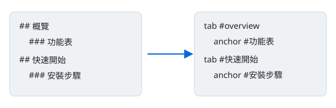

這段文字位於第一個 `## ` 之前，會顯示在標題下方（每個分頁都看得到）。

## 概覽 {#overview}

一般段落，含 **粗體**、`行內程式碼` 與[跳到安裝步驟](#安裝步驟)、[跳到 English 分頁](#english)。

> [!NOTE]
> 這是備註卡片。

> [!WARNING] 自訂標題：請先備份
> 警告卡片可以有自訂標題。

### 功能表

| 功能 | 狀態 | 說明 |
|---|---|---|
| 分頁 | ✅ | 每個 `## ` 一個分頁 |
| 子錨點 | ✅ | 每個 `### ` 都有可分享的 id |
| 很長的欄位 | ✅ | averyveryverylongunbrokenwordthatwouldnormallyoverflowthecolumnonaphone_averyveryverylongunbrokenword |

### 待辦清單

- [x] 已完成項目
- [ ] 未完成項目
- 一般項目

## 快速開始

### 安裝步驟

```bash
npm install
node src/cli.js build examples/example.md --out examples/example.html --embed-images --check
```

> [!TIP]
> 加上 `--check` 會自動驗證所有錨點。

### 對應關係圖



## English

This tab is English. Deep link: [Install steps](#安裝步驟). Duplicate headings get suffixes:

### Notes

First.

### Notes

Second (id `notes-2`).
